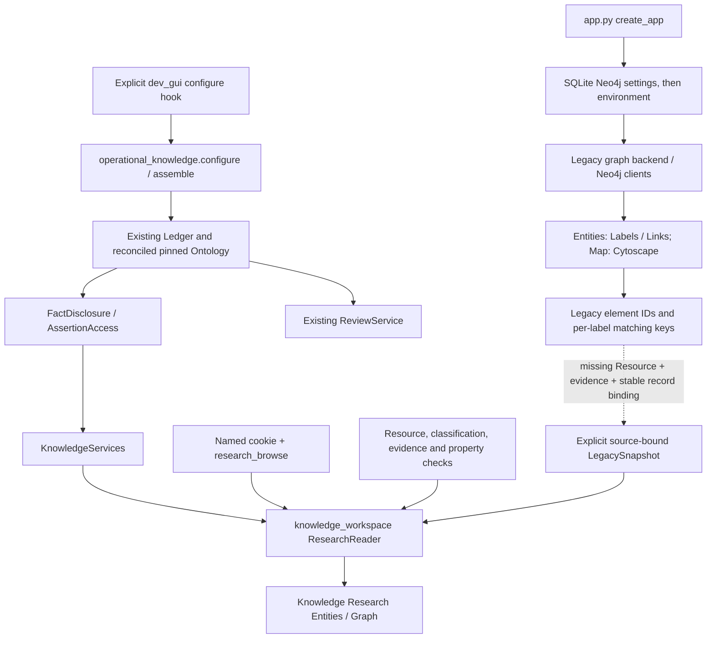

# Operational entity integration, Prompt 18

The development Neo4j source is reachable, but a governed connection to its
existing entities remains **blocked by missing source bindings**. Service assembly
and frontend defects are separate, addressed issues. No operational entity is
represented as accepted knowledge by this change.

`create_app()` builds the legacy graph and registers native blueprints. It loads
the persisted `neo4j_config` and password, then falls back to graph environment
configuration. Labels uses `LabelService`, Links uses the existing service and
registry APIs, and `/map` uses the existing graph schema and Cytoscape components.
The label schema service can inspect Neo4j schema and per-label matching keys;
instance lookup and cross-database links also use `elementId`. Neither a schema
definition nor a matching key grants Resource access.

The governed path deliberately does not read arbitrary Neo4j query results.
`FactDisclosure` verifies ledger graph binding, ontology version, current accepted
decision, matching applied receipt, Resource risk/authority, evidence and property
policy. `ResearchReader` serializes nodes, properties and relationships through
that path before search or pagination. Relationships require authorized endpoint
support. The new hook attaches these existing implementations and ReviewService
to the same ledger and settings store. It does not attach a graph writer.

Prompt 17's Stage 3 human policy resolves `HumanIdentity` separately from AI
`BoundIdentity`. Human browsing requires an unlocked, enabled named cookie
session, same origin and explicit `research_browse`; AI endpoint/model approval is
irrelevant to it. Review also requires `review_read` and existing reviewer
authority. AI transport retains its separate disclosure/credential/consent
checks. Administrators do not bypass any content permission.

## Findings by layer

| Layer | Finding |
|---|---|
| Service assembly | Normal factory never attaches KnowledgeServices/ReviewService. Explicit hook now supports existing state without initialization. |
| Graph connection | Authorized localhost development graph reached successfully with standalone read-only driver. It does not imply governed service readiness. |
| Resource/evidence grants | No new grants made; existing graph keys do not establish Resource/evidence association. |
| Stable identity | File `(path,host)` uniqueness exists. Sampled Dataset has no unique constraint. Candidate keys require an approved source namespace and canonicalization/versioning contract. |
| Receipts | No receipts fabricated or inferred from graph presence. Legacy records stay unreviewed/unverified. |
| Authorization coupling | Existing human adapter already provider independent. Misleading frontend provider error corrected for Research. |
| Frontend | Initial Research page loaded layout only, leaving records absent until explicit search. Now requests bounded authorized discovery automatically for Graph/Entities. |

## Authorized Scenario A inspection

Authorization is recorded in the user-supplied `scidk_prompt_18_01.txt`. Endpoint
classification used localhost plus Docker Compose labels and bind paths tied to
`/home/patch/PycharmProjects/scidk/docker-compose.neo4j.yml`, service `neo4j` and
that checkout's `data/neo4j` tree. No persisted primary Neo4j config was found in
its settings store; dotenv specifies localhost port 7687. Credentials stayed in
memory and were not printed or copied into this repository.

The standalone driver used read access, transaction timeouts and fixed queries:
labels (limit 64), relationship types (64), property names (128), node key shapes
(32), edge key shapes (16), then Dataset/File/CONTAINS key shapes (4 each) and
constraint metadata (32). No property **values**, personally identifying records,
scientific contents, storage bytes or bulk exports were inspected.

Observed labels include File, Folder, Scan, Dataset and scientific/interpreter
labels. Sampled Dataset keys: `profile`, `scan_id`, `created_at`, `type`, `host`,
`path`, `name`, `updated_at`. Sampled Files include `provider_id`, `host_id`,
`host_type`, `path`, `host`, filename/size/format/time metadata. Four sampled
CONTAINS edges have no properties. Reported uniqueness constraints cover only
File and Folder `(path,host)`. These bounded findings do not prove all graph
records have the same shape.

**Missing contract:** an administrator must associate each permitted source and
stable external record key with an exact `{namespace,resource_id}` and actual
matching ledger evidence, including version/hash/retrieval provenance. Define
Dataset identity independently of mutable names/Neo4j IDs; define relationship
identity and its own supporting evidence and endpoint bindings. A profile name,
scan UUID or filesystem locator alone is insufficient. Reconcile the actual
catalog explicitly before including scientific labels/properties. No new
ontology or source binding is inferred here.

Until supplied, the operational legacy adapter stops. Existing LegacySnapshot
supports at most 128 explicitly bound records/128 KiB and no legacy relationship
traversal. Do not claim graph exploration of operational legacy memberships.

## Runtime and preservation

No listeners existed on 5001/5002/5003 at preflight. No existing services or Docker
containers were stopped/restarted/modified. Never use the normal factory to
inspect this graph read-only: its `_ensure_person_label()` startup hook can write
labels. The documented isolated launcher clears graph configuration, uses memory
backend, disables scheduler/concept graph and attaches existing governed state
explicitly. Its local Files/Resources services remain available. The native
Entities, Labels/Links, Maps/Canvas, saved maps, Files/rclone, Source → Schema →
Mapping, annotations, interpreters and NIH DMS routes were not retired.

Readiness reports configuration, the administrator's own purpose/Resource/evidence
checks and ledger provenance availability without identifiers, locators, counts
or records. It never grants access, probes Neo4j or asserts that applied receipts
prove present-day graph reachability. Full setup and limitations are in
`docs/demo/scidk-operational-startup.md`.
